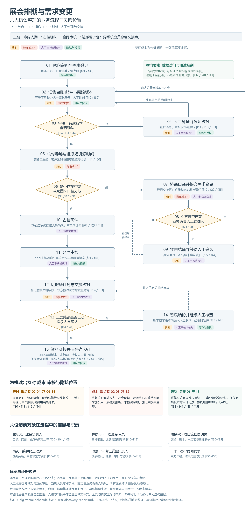

# DHLS 展会排期与需求变更

基于六人合成访谈的行业调研、流程分析及成果生成工具。重点研究版本交接、排期冲突、需求变更、人工确认和资料授权。

当前项目提供研究资料与文档生成命令，尚未实现生产排期系统、自动锁档、合同签署或业务接口。原始访谈中的人物、业务问题及工时基线均为合成演练，不能当作企业真实经营数据。

## 直接查看成果

| 成果 | 文件 |
| --- | --- |
| 需求访谈原件 | [discovery-report.md](data/source/discovery-report.md) |
| 行业及 GitHub 项目调研 | [Markdown](docs/reports/展会排期与需求变更项目调研报告_20261023_优化版.md) · [Word](docs/reports/展会排期与需求变更项目调研报告_20261023_优化版.docx) |
| 访谈流程图 | [高清 PNG](docs/assets/展会排期与需求变更_访谈流程图.png) |
| 流程节点与风险说明 | [说明及 Mermaid 源码](docs/process/展会排期与需求变更_访谈流程图说明.md) |
| AI 数智化转型后目标流程 | [高清 PNG](docs/assets/展会排期与需求变更_AI数智化转型后流程图.png) · [说明及 Mermaid 源码](docs/process/展会排期与需求变更_AI数智化转型后流程图说明.md) |



## 安装

需要 Python 3.11 或以上。以下命令在仓库根目录执行：

```sh
git clone https://github.com/kelleyxing-netizen/dhls.git
cd dhls
python -m venv .venv
```

Windows PowerShell 激活环境后安装依赖：

```powershell
.\.venv\Scripts\Activate.ps1
python -m pip install -r requirements.txt
```

macOS 或 Linux：

```sh
source .venv/bin/activate
python -m pip install -r requirements.txt
```

也可使用环境中已提供的 Python 与依赖，无需重复创建虚拟环境。

## 运行

```sh
python scripts/build.py check
python scripts/build.py report
python scripts/build.py flow
python scripts/build.py ai-flow
python scripts/build.py all
python -m unittest discover -s tests -v
python examples/demo.py
```

- `check`：检查成果文件、DOCX 字体、PNG 尺寸、流程节点和 Markdown 相对链接，不重新生成文件。
- `report`：生成并规范化 Word 报告，同步生成 Markdown。读取的是脚本中已核查的研究内容，不会重新检索互联网或自动更新行业数据。
- `flow`：按固定访谈节点重绘流程图。修改访谈或业务规则后，需要人工同步维护节点说明和 Mermaid。
- `ai-flow`：从同一组目标节点与分支生成 AI 转型目标流程图、说明和 Mermaid；明确区分系统、AI 与人工。这是未实施的方案，不会执行生产业务动作。
- `all`：依次生成报告、绘图并校验。

字体默认使用 Windows 微软雅黑。其他环境需要安装支持中文的字体，并设置 `DHLS_FONT_PATH` 和 `DHLS_FONT_BOLD_PATH` 指向实际字体文件。Markdown 的显示字体由阅读器决定；Word 中英文字体统一为微软雅黑。生成脚本不会下载或分发字体。

Word 视觉校验需要本机 Microsoft Word 或 LibreOffice。CI 目前做结构与内容检查，不替代渲染后的逐页检查。

## 仓库结构

```text
dhls/
├── README.md
├── LICENSE
├── AGENTS.md                # 后续对话的提交与推送约定
├── .gitignore
├── CHANGELOG.md
├── CONTRIBUTING.md
├── requirements.txt
├── src/dhls/
│   ├── main.py              # 命令分发入口
│   ├── core/                # 生成与成果校验
│   └── utils/               # 路径及字体解析
├── docs/
│   ├── design.md
│   ├── api.md
│   ├── reports/             # DOCX 和 Markdown 调研报告
│   ├── assets/              # 定稿流程图
│   └── process/             # 节点说明及可编辑源码
├── tests/
├── examples/
├── scripts/                 # 构建及显式同步命令
├── config/default.json      # 非机密路径配置
├── data/source/             # 合成访谈原件
└── .github/                 # CI 与协作模板
```

## 更新与自动推送约定

本项目已按用户要求记录：后续在本仓库完成有文件变更的每轮工作后，先校验、更新 `CHANGELOG.md`，再提交并推送至 `origin/main`。这是项目代理的工作约定，不是后台监控或定时任务；没有文件变更时不创建空提交。执行环境仍需具备 GitHub 写入凭据与网络访问。

也可手动运行 `python scripts/sync.py --message "docs: 更新调研成果"`。脚本会展示变更文件，校验后提交并推送，不使用强推；请先确认工作区变更都属于本次准备发布的内容。

## 数据与许可证

调研截至2026年10月23日。来源链接、核验深度、许可证分歧和未验证假设见报告。潜在成本不等于已发生损失，人工确认不可省略，试点数据路径限定为脱敏只读导出。

仓库原创代码与原创文档采用 MIT 许可证。`data/source/` 中的输入材料及文档引用的第三方资料，其权利仍归原权利人；本仓库不重新授予这些材料的权利，也不包含第三方项目源码或字体。
