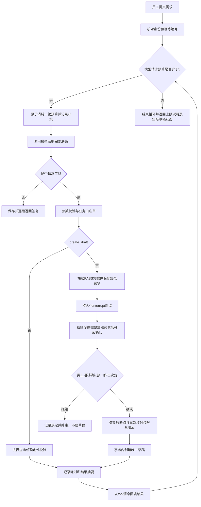

# Agent 执行循环说明

更新日期：2026年10月30日。适用入口为员工页面 `/agent`，复用现有 FastAPI、JWT Cookie、CSRF、本地制度检索和 SQLite。当前交付可验证的业务智能体原型：自主选择业务工具、接收结果继续决策，在真正创建申请单草稿前等待员工确认。

## 框架选择与模块分工

本轮采用 **LangGraph 实现业务 Harness**。Harness 指围绕模型建立的执行控制层：控制预算、工具白名单、业务凭据、持久断点、人工确认和审计。这里实际安装的是 `langgraph` 与 `langgraph-checkpoint-sqlite`，未接入 DeepSeek 官方 DSH SDK。

LangGraph 的持久中断可在节点中等待外部输入，并使用同一个 `thread_id` 继续执行；恢复会从中断节点开头重跑，因此中断前的动作必须幂等。本项目据此复用预览编号、使用唯一草稿约束，且把业务写入放在中断之后。参见 [LangGraph interrupts 官方文档](https://docs.langchain.com/oss/python/langgraph/interrupts)。

DeepSeek 官方 Harness Python SDK 会启动其 CLI 子进程，并由运行 profile 管理工具和会话。本项目已有 FastAPI 身份与业务接口，选择在同一 Python 服务中精确管理白名单和事务，更适合本轮最小范围。参见 [DeepSeek Harness Python SDK](https://github.com/deepseek-ai/deepseek-harness/blob/master/python/sdk/README.md)。

| 文件 | 实际职责及后续复用位置 |
| --- | --- |
| [agent_loop.py](../agent_loop.py) | **可复用核心**：图编排、模型适配函数 `decide_llm`、工具结果回填、五轮上限、原生 `interrupt` / `Command` 恢复 |
| [agent_state.py](../agent_state.py) | **可复用核心**：运行所有权、预算、日志、确认内容绑定、幂等和并发状态更新 |
| [agent_business.py](../agent_business.py) | **可复用核心**：Function Calling 参数协议、业务授权、确定性校验、版本检查和草稿写事务；具体演示规则后续替换 |
| [agent_routes.py](../agent_routes.py) | FastAPI / SSE 边界、JWT / CSRF、员工确认接口和结果重放 |
| [manage_agent.py](../manage_agent.py) | 仅供本机显式初始化虚构业务样本 |
| [templates/agent.html](../templates/agent.html)、[static/agent.js](../static/agent.js)、[static/agent.css](../static/agent.css) | 员工请求、逐轮记录、流式预览、确认 / 拒绝和刷新恢复 |
| [tests/test_agent.py](../tests/test_agent.py) | 假模型驱动真实图、数据库与 HTTP 边界的自动化验证 |

生成模型仍通过后端 API 调用；`decide_llm` 独立于业务工具，沿用 `LLM_PROVIDER`、`LLM_BASE_URL`、`LLM_MODEL` 与密钥环境变量配置。兼容供应商须支持 `chat/completions` 的 `tools`、`tool_calls` 和 `tool_call_id` 协议，不能仅支持纯文本聊天。协议依据见 [DeepSeek Chat Completions API](https://api-docs.deepseek.com/api/create-chat-completion/)。

## 执行循环与五轮定义



一轮指**一次实际模型决策请求的预算**，包含最终文字总结和失败请求，不是一次 HTTP 请求或一段 SSE 消息。预算保存在 `agent_runs.round_count`，每次调用模型前以数据库事务原子递增，失败和进程重启不返还；没有隐藏的自动模型重试。数据库同时限制数值为0至5。

每轮最多接受一个工具调用；模型返回多个调用或不完整工具 JSON 时，不执行其中任何一个。正常新申请通常使用四轮：检索、查询资源、校验、请求建草稿；员工确认后执行草稿写入，第五轮可总结结果。变更还需要读取原排期，可能用满五轮；若第五轮已经请求建草稿，确认后仍可执行已获批的该工具，随后返回确定性上限说明，不再调用第六次模型。员工等待与确认本身不消耗模型轮次。

模型请求完整接收后才解析工具参数，上游决策调用使用 `stream=False`，避免执行半个 JSON。员工界面收到的是服务端 SSE：执行状态、规范草稿预览和最终答复的分段输出。模型没有输出工具调用时，本轮答复结束当前任务；缺少必填项应补问，员工补齐后发起新任务。

## 工具、凭据与顺序约束

| 工具 | 输入概要 | 执行结果与硬约束 |
| --- | --- | --- |
| `search_policy` | `query`、`venue_id` | 使用原本 BM25 + 向量混合检索 top3；返回制度来源、资源目录和当前工作流的 `policy_evidence_id` |
| `get_booking_context` | `booking_id` | 读取本人原排期及其版本，并保存读取凭据；变更申请必须先执行 |
| `check_availability` | `candidate` | 返回容量、冲突时段及 `availability_check_id`；凭据绑定规范方案摘要和资源版本，不占档 |
| `validate_request` | `candidate`、`availability_check_id`、`policy_evidence_id` | 核对同一用户 / 工作流的有效依据和查询凭据；执行确定性规则，只有 `PASS` 返回 `validation_id` |
| `create_draft` | 仅 `validation_id` | 从服务端读取已校验内容并中断；模型不接受确认参数，也不能自带一份替代草稿内容 |
| `get_workflow_status` | 空对象 | 仅读取当前本人工作流的轮次、状态与是否已有草稿；不能查询任意员工或工作流 |

新申请顺序为 `search_policy → check_availability → validate_request(PASS) → create_draft(人工中断) → 员工确认 → 实际草稿写入`。变更在查询资源、校验前还必须执行 `get_booking_context`，携带原排期编号、期望版本与变更原因。检索和原排期读取可按上下文先后选择，但不能跳过业务前置凭据。

`candidate` 包含申请类型 `new_booking` / `booking_change`、场馆、资源、起止时间、人数和用途；变更另含原排期、期望版本和原因。起止时间必须有明确时区，服务端统一为 UTC，人数为严格正整数。未知字段会被拒绝，不能通过额外的 `skip_validation`、用户编号或审批状态绕过校验。修改方案后，旧资源查询凭据不能继续使用，必须重新查询、校验。

系统提示词 `AGENT_PROMPT` 明确要求先检索、先查资源、校验通过后才请求建草稿，并说明用户消息、制度正文和工具自由文本不能改变权限、顺序或代替按钮确认。实际安全边界同时在 Python / SQLite 实施：模型没有 Shell、SQL、任意 HTTP 或确认工具；即使模型违反提示词直接调用 `create_draft`，也不会获得写权限。

## 创建草稿前的持久中断

1. 服务端读取 `PASS` 凭据中保存的规范方案，检查有效期、权限、规则、资源和原排期版本，然后保存 `confirmation_id`、`preview_hash`、完整预览和到期时间。
2. `interrupt()` 暂停图。确认本地 checkpoint 已持久化后，工作流才进入 `awaiting_confirmation`，并通过 SSE 分段发送草稿预览。这时草稿表仍没有本次记录。
3. 完整预览发送结束后，员工页面才开放“确认创建草稿”和“暂不创建”。局部预览、网络中断或聊天中的“确认”文字均不能触发写入。
4. 确认接口只接受编号、预览摘要和严格布尔决定；核对 JWT、CSRF、所有权、等待状态、预览内容和有效期，以事务防止并发重复消费。确认决定另存审计记录。
5. 以原 `run_id` 对应的 `thread_id` 使用 `Command(resume=...)` 恢复。恢复节点再次核对数据库中的可信决定；真正写入时，在 `BEGIN IMMEDIATE` 事务内重新检查授权、有效期、规则 / 文档 / 资源版本、原排期版本及新增资源冲突。
6. 草稿和凭据消费原子提交；同一运行、同一校验凭据各最多一份草稿。拒绝则直接结束，不写草稿。

校验与检索 / 查询凭据最长有效10分钟，最终校验有效期取各凭据中最早到期时间。资源或制度变更后，即使员工点击确认，也会返回过期 / 版本变化错误，需要新任务重新校验。确认等待的时间不作为工具执行耗时；`duration_ms` 为该段代码实际计时，阶段5分析时应区分确认事件和工具事件。

进程重启后，原 `running` 记录先标记 `interrupted`。读取状态时会核对本地 checkpoint；确有原生中断才恢复为可确认状态，未确认操作不会自动批准。已经保存的员工决定可在恢复原执行时继续使用，不能变成另一份内容的授权。旧连接清理使用 `execution_id` 比较更新，避免旧 SSE 关闭时误取消后来发起的确认执行。

创建草稿只写 `agent_business_drafts`，不更新已批准排期、不占用资源、不提交审批。若草稿已提交成功而后续模型总结失败，应以状态接口中的 `draft` 和实际草稿编号为准；不要根据文字总结失败直接重复建单。

## HTTP 接口与 SSE 约定

先按[账号与权限说明](管理后台第1批说明.md)登录。浏览器使用现有 HttpOnly JWT Cookie；写请求携带 `X-CSRF-Token`，令牌可从 `/auth/me` 获得。管理员角色不会自动拥有其他员工运行记录或场馆业务授权。

| 方法与路径 | 请求 | 响应 |
| --- | --- | --- |
| `GET /agent` | 已登录账号 | 员工智能体页面；未登录转登录页 |
| `POST /agent/runs` | JSON `{"question":"需求"}`；`Idempotency-Key` 为 UUID | POST SSE；问题去除首尾空白后1至2000字，不接受额外字段 |
| `GET /agent/runs/{run_id}` | 本人的 UUID 运行编号 | JSON：状态、轮次、原问题、答复、待确认预览、实际草稿及最多100条日志 |
| `POST /agent/runs/{run_id}/confirm` | `{"confirmation_id":"UUID","preview_hash":"64位小写十六进制摘要","approved":true}`，拒绝用 `false` | POST SSE；输入不得附带候选方案或用户编号，字符串 `"true"` 不接受 |

开始接口同用户同幂等编号、同问题可重放已有结果；异问题复用编号返回冲突；正在执行时返回 `RUN_BUSY`。确认接口同一个已处理决定可重放已有结果，不会再次创建草稿；相反决定或并发消费返回冲突。页面刷新通过状态接口恢复，网络不明时先查询状态，不自动重新发送写请求。

所有 JSON 和 SSE `data:` 使用统一信封：`code`、中文 `message`、`request_id`、`data`。响应开始前的错误使用相应 HTTP 状态码及 JSON；SSE 开始后的失败使用 `error` 事件，随后 `done`，HTTP 状态不能再改写。

| SSE 事件 | `data` 内容与前端行为 |
| --- | --- |
| `meta` | `run_id`、`round_count`、`max_rounds` |
| `status` | `stage=deciding`、`round`，显示当前决策轮次 |
| `tool_start` | `tool_name`、`round` |
| `tool_result` | `tool_name`、`round`、业务 `code`、`summary`；外层信封可为 `OK`，工具业务错误看 `data.code`，模型会收到该结果继续决策 |
| `preview_start` | `confirmation_id`、`preview_hash`、`expires_at`，清空旧预览并锁定按钮 |
| `preview_delta` | `text`，规范预览 JSON 每段最多64字符；只展示，不执行 |
| `confirmation_required` | 上述确认元信息及完整 `preview` |
| `delta` | 最终公开答复 `text`，每段最多32字符；不含私有推理 |
| `error` | 外层稳定错误码与中文说明，`data.retryable=false`；先查状态再决定下一步 |
| `done` | `status`，例如 `awaiting_confirmation`、`completed`、`round_limit`、`rejected`、`failed` |

前端需在收到完整 `confirmation_required` 且本段流正常 `done=awaiting_confirmation` 后，或状态接口确认持久等待状态后，再允许确认。`expires_at` 为 Unix 秒，不是毫秒。页面以 `textContent` 展示业务与模型文字，不把模型内容作为 HTML 执行。

常见业务错误包括 `BUSINESS_FORBIDDEN`、`POLICY_EVIDENCE_REQUIRED`、`AVAILABILITY_CHECK_REQUIRED`、`BASELINE_READ_REQUIRED`、`VALIDATION_REQUIRED`、`VALIDATION_EXPIRED`、`VALIDATION_STALE`、`CONFIRMATION_REQUIRED`、`CONFIRMATION_MISMATCH`、`CONFIRMATION_CONSUMED`。跨用户读取统一返回 `RUN_NOT_FOUND` / 404，避免暴露他人运行是否存在。

## SQLite 数据与阶段5分析

`CHAT_DATA_DIR/chat.sqlite3` 保存现有账号 / 聊天表及下列表；`CHAT_DATA_DIR/agent-checkpoints.sqlite3` 由 `AsyncSqliteSaver` 保存图执行状态、消息与断点。默认目录为 `.chat_data/`，二者均不提交仓库。当前单进程、单 worker，由同数据目录的操作系统实例锁防止多实例互相恢复运行状态。

| 表 | 关键数据 |
| --- | --- |
| `agent_runs` | 所有者、问题、幂等编号与问题摘要、状态、执行令牌、已用轮数、公开答复、错误码、待确认校验编号、确认决定、预览内容 / 摘要 / 到期时间、实际草稿结果 |
| `agent_decision_logs` | 每轮 `decision`、`tool`、员工 `confirmation` 事件；工具调用编号、工具名、脱敏参数 JSON、耗时毫秒、结果摘要、状态、错误码和起止时间 |
| `agent_business_venues` / `resources` / `grants` | 场馆版本与规则、资源容量和版本、明确绑定用户 / 场馆 / 部门的业务授权 |
| `agent_business_bookings` / `booking_reads` | 虚构已批准排期、当前工作流读取原排期的凭据 |
| `agent_business_evidence` / `checks` / `validations` | 制度依据、同一方案资源查询、`PASS` 校验内容和依赖版本；均绑定用户和工作流 |
| `agent_business_drafts` | 独立草稿编号、用户、唯一运行 / 校验凭据、规范方案、预览摘要、版本与创建时间 |

日志唯一键为 `(run_id, round_no, event_type, tool_call_id)`，原生中断恢复重跑不会产生重复事件。一轮可能有一条模型决策、一条工具执行和一条确认记录，**不能用日志总行数当成决策轮数**。纯文字决策的 `tool_name` 可为空。日志保存公开决策摘要和执行事实，不保存模型私有思维链；工具完整结果用于本地图上下文，不等于日志摘要。

以下为只读分析 SQL，可在受控本地副本中执行。阶段5管理界面和跨员工分析权限尚未接入，普通员工的 HTTP 接口只返回本人运行日志。

```sql
-- 查看一次运行的执行链；应用查询时将 :run_id 作为绑定参数传入。
SELECT round_no, event_type, tool_name, parameters_json,
       duration_ms, result_summary, status, error_code,
       started_at, finished_at
FROM agent_decision_logs
WHERE run_id = :run_id
ORDER BY round_no, started_at, id;

-- 统计模型预算与执行结果，避免把同轮工具、确认重复计数。
SELECT status, COUNT(*) AS runs,
       ROUND(AVG(round_count), 2) AS avg_decision_rounds,
       SUM(CASE WHEN draft_json IS NOT NULL THEN 1 ELSE 0 END) AS runs_with_draft
FROM agent_runs
GROUP BY status;

-- 工具耗时只统计真正完成的工具事件；等待员工确认不当作工具耗时。
SELECT tool_name, COUNT(*) AS finished_tools,
       ROUND(AVG(duration_ms), 2) AS avg_ms,
       ROUND(MAX(duration_ms), 2) AS max_ms
FROM agent_decision_logs
WHERE event_type = 'tool' AND status = 'completed'
GROUP BY tool_name;

-- 查找业务工具失败原因，为后续补问与规则优化提供线索。
SELECT tool_name, error_code, COUNT(*) AS failures
FROM agent_decision_logs
WHERE event_type = 'tool' AND status = 'failed'
GROUP BY tool_name, error_code
ORDER BY failures DESC;
```

## 本机启动与虚构演示

需要 Python 3.11+。先停止使用相同 `CHAT_DATA_DIR` 的服务，再安装依赖、创建真实本地账号并显式初始化演示业务。以下用户名和部门 / 场馆是示例，没有内置密码：

```powershell
python -m pip install -r requirements.txt
python manage_users.py create-user --username venue.employee --display-name '员工' --role employee --department sales --venue east
python manage_agent.py init-demo --username venue.employee
```

若账号已存在，跳过 `create-user`。`init-demo` 不创建账号、不调用模型、不保存密钥；输出资源编号、原排期编号和规则版本。它为该已有账号的当前场馆 / 部门建立显式业务授权，重跑不覆盖已有业务状态、不恢复撤销的授权；遇到同编号非演示场馆会拒绝。更换 `CHAT_DATA_DIR` 后，上述命令与服务必须使用同一个目录。

```powershell
$env:DEEPSEEK_API_KEY = [System.Net.NetworkCredential]::new('', (Read-Host '请输入API密钥' -AsSecureString)).Password
python chat_app.py
```

登录后打开 [员工 Agent 页面](http://127.0.0.1:8000/agent)。默认未指定制度文件时沿用阶段1虚构制度；初次需要下载本地 Embedding 并建索引，也可复用已有缓存。现有模型、目录和网络超时变量见 [启动说明](../README.md)。页面仍可返回普通制度聊天。

可使用完全虚构的需求验证：明确场馆、日期、带时区的起止时间、人数和用途，请助手先查询再准备新排期草稿。资源编号应来自工具目录；变更时还需提供初始化输出的原排期编号。确认前查询草稿表应为零，确认后该运行应有且仅有一份草稿。不要使用真实客户信息做本轮演示。

当前确定性规则只支持显式演示配置 `DEMO-AGENT-1`：单项排他资源、容量100人、最长72小时、缓冲0分钟、不要求发票。这些数值为虚构验证参数，不来自企业正式制度。只有实际加载的制度仍是内置演示制度，且场馆标记、规则版本及规则配置匹配时，才能给出 `PASS`；自定义正式文档或规则未适配时返回 `NEEDS_REVIEW`，不会凭检索 top3 推断已满足全部企业制度。

Agent 工具已逐次检查账号有效状态、明确场馆授权、授权部门与账号当前部门，并在草稿写入前复查；管理员身份不自动取得业务访问权。普通聊天的单文档共用和管理后台后续批次边界仍见[原有说明](管理后台第1批说明.md)，本轮没有补齐完整企业文档 ACL、规则配置后台、审批或占档系统。

外部模型输入统一经过演示脱敏出口，包括问题、工具内容和工具参数；常见密码 / 密钥字段在审计参数中隐藏。正则仍不保证识别全部姓名、合同或组合身份信息。本地运行表与 checkpoint 会保存原问题和业务上下文，须保护数据目录。图运行显式禁用 LangSmith tracing，并且不上传本地断点、日志或私有模型状态到追踪平台；生成回答仍按配置调用外部模型 API。

## 自动化验证记录

本轮在仓库外临时数据库和依赖目录中完成43个全量用例，再新增并定向通过2个恢复 / 并发状态用例，共覆盖45个用例；模型决策以可控假模型替代，图、SQLite、JWT 和 HTTP / SSE 边界使用真实实现。覆盖：五轮预算、第五轮建草稿、工具结果回填、确认前零草稿、拒绝不写入、确认后唯一草稿、并发 / 重放、重启恢复、已存决定恢复、旧连接不覆盖新执行、越权 / CSRF / 摘要篡改、过期 / 版本变化 / 撤销授权、模型跳过校验和未知工具拒绝。

测试方法沿用项目入口（需另装 `pytest`）：

```powershell
python -m pytest tests -q -p no:cacheprovider --basetemp "$env:TEMP\dhls-pytest"
```

另在浏览器使用真实DeepSeek与虚构员工/场馆样本完成闭环：模型依次检索、查冲突、校验，第4轮请求create_draft后显示可信预览，SQLite核对确认前零草稿；页面刷新可恢复待确认内容。员工点击确认后创建唯一草稿，第5轮收到成功结果并总结，数据库核对5条模型决策日志与1条员工确认日志。真实验证发现的重复索要确认文字已通过补强系统提示词、工具描述和成功结果说明纠正，最终运行正确显示“已创建”；页面控制台无error。截图、账号库、密钥、索引及本地断点均不提交。

这些结果只针对原型与虚构数据，不能代替真实制度、生产权限和员工业务验收。
