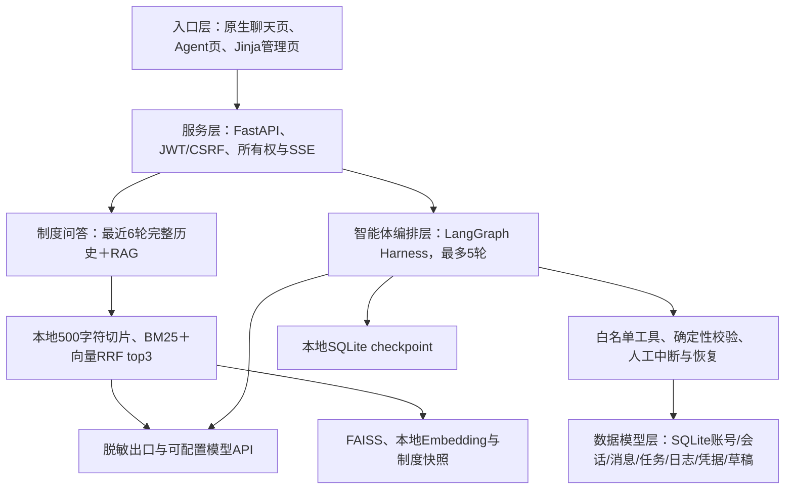

# 设计说明

本页对应当前可运行源码，更新于2026年10月31日。历史调研和报价保留原日期，见[文档索引](README.md)。目录整理使用可安装的 `src/dhls` 包，业务行为保持现有员工问答、身份权限和草稿确认范围。

## 四层结构

| 位置 | 职责 |
| --- | --- |
| [main.py](../src/dhls/main.py) | 应用生命周期、普通问答/登录/管理入口、SSE和错误边界 |
| [api/agent.py](../src/dhls/api/agent.py) | Agent新任务、状态与可信确认HTTP边界 |
| [core/rag.py](../src/dhls/core/rag.py) | 阶段1切片、Embedding、FAISS、混合检索、脱敏和独立LLM调用，保留CLI |
| [core/chat.py](../src/dhls/core/chat.py)、[store.py](../src/dhls/core/store.py)、[auth.py](../src/dhls/core/auth.py) | 环境配置、历史/引用、上游流、SQLite、JWT/Argon2/CSRF |
| [core/agent_loop.py](../src/dhls/core/agent_loop.py)、[agent_state.py](../src/dhls/core/agent_state.py) | 五轮预算、工具回填、中断、状态、确认绑定和审计日志 |
| [core/agent_business.py](../src/dhls/core/agent_business.py) | 授权、检索证据、资源/基线版本、确定性规则和草稿写事务 |
| [utils/locks.py](../src/dhls/utils/locks.py) | 单数据目录OS实例锁，服务和账号CLI共用 |
| `cli/`、`static/`、`templates/` | 运维CLI和随wheel打包的界面资源 |

## 关键约束

模型只决定下一个白名单调用，服务端拥有执行权。新申请先检索、查资源、校验PASS，变更另读本人原排期；create_draft先保存规范预览并持久中断，员工确认接口才有权恢复。数据库在写入时再次核验身份、授权、期限、内容摘要和依赖版本；提示词不能替代这些检查。

每次实际决策请求前先原子消耗轮次，失败和重启不退，最多5次，确认不额外消耗轮数。日志区分decision/tool/confirmation，不保存模型私有思维链。checkpoint与业务数据均保留在本地，外部追踪关闭。普通问答仅使用最近6个成功完整问答对；不同Agent run不自动共享上下文或凭据。

当前运行仍固定loopback、单worker，OS实例锁防止同数据目录多进程恢复竞争。默认数据目录相对当前工作目录；静态资源与模板相对已安装包位置，避免部署后写site-packages或找不到页面。`requirements.txt`是运行依赖唯一来源，包构建从该文件读取。

## 当前边界与验收材料

业务工具具备显式账号/部门/场馆授权，但普通问答仍共用一份启动时制度；文档ACL及管理后台后续批次没有因目录整理自动完成。仅明确初始化的虚构规则可PASS，草稿不提交审批、不占档。外发正则脱敏为原型机制，生产接入按[上线清单](prelaunch-checklist.md)逐项验收。

[30条评测](../data/evaluation_cases.json)是待执行题集；现有自动化回归使用替身模型验证真实图、鉴权、数据库与SSE。[评测说明](evaluation.md)区分结构校验、行为评分和生产验收，不能混算通过率。

## 旧入口迁移

| 整理前 | 当前入口 |
| --- | --- |
| `python chat_app.py` | `python -m dhls` |
| `python stage1_rag.py ...` | `python -m dhls.core.rag ...` 或 `python examples/demo.py ...` |
| `python manage_users.py ...` | `python scripts/manage_users.py ...` 或 `python -m dhls.cli.users ...` |
| `python manage_agent.py ...` | `python scripts/manage_agent.py ...` 或 `python -m dhls.cli.demo ...` |
| `docs/CHANGELOG.md` | 根目录[CHANGELOG.md](../CHANGELOG.md) |

先安装 `python -m pip install -e .`。源码移动不修改原数据目录；从原仓库根目录运行仍会使用根目录下的数据。另换工作目录时显式设置数据及缓存的绝对路径。
