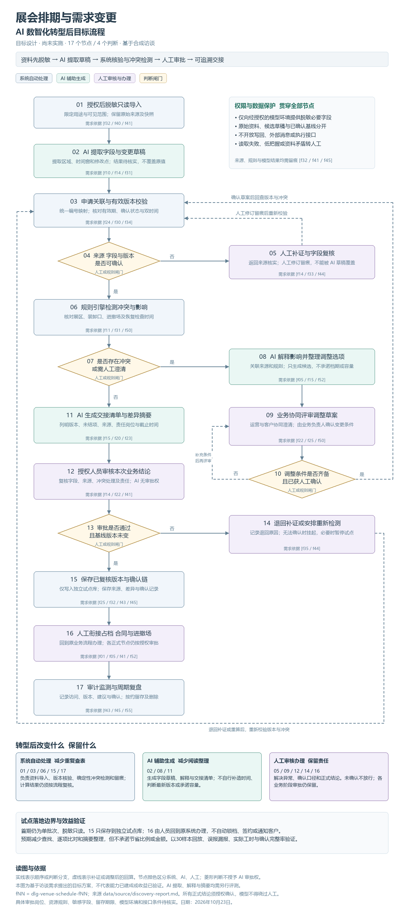
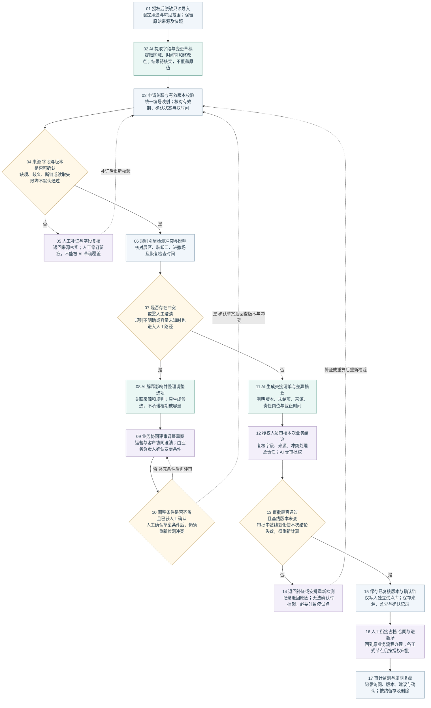

# 展会排期与需求变更 AI 数智化转型后目标流程

目标设计日期：2026年10月23日。此图为建议方案，尚未实施，依据合成访谈整理，不代表企业真实运营现状或已验证能力。

## 设计结论

将多源人工查找和逐项核对转为“脱敏导入、AI生成候选、系统版本校验、确定性规则检测、人工确认、可追溯交接”。AI减少阅读和草稿整理；规则系统负责可计算的校验；业务人员保留异常处置、正式审批与原系统执行责任。

图中17个节点包含13个操作和4个判断点。颜色区分系统自动处理、AI辅助生成和人工审核办理，菱形为判断闸门。虚线表示补证、调整或退回后的重新计算。

**目标能力不等于现有能力。** 原访谈支持的是需求与约束；AI提取、解释、摘要，以及自动关联、规则检测和版本控制均为拟建能力，需用真实授权样本验证。图中“需求依据”不表示访谈已经证明工具具备该能力。

## 节点与边界

| 节点 | 类型 | 动作或判断 | 处理边界 | 需求依据 |
| --- | --- | --- | --- | --- |
| 01 | 系统自动处理 | 授权后脱敏只读导入 | 限定用途与可见范围；保留原始来源及快照 | f32 / f40 / f41 |
| 02 | AI辅助生成 | AI 提取字段与变更草稿 | 提取区域、时间窗和修改点；结果待核实，不覆盖原值 | f10 / f14 / f31 |
| 03 | 系统自动处理 | 申请关联与有效版本校验 | 统一编号映射；核对有效期、确认状态与双时间 | f24 / f30 / f34 |
| 04 | 判断闸门 | 来源 字段与版本 是否可确认 | 缺项、歧义、断链或读取失败均不默认通过 | f31 / f33 / f35 / f44 |
| 05 | 人工审核或办理 | 人工补证与字段复核 | 返回来源核实；人工修订留痕，不能被 AI 草稿覆盖 | f14 / f33 / f44 |
| 06 | 系统自动处理 | 规则引擎检测冲突与影响 | 核对展区、装卸口、进撤场及恢复检查时间 | f11 / f31 / f50 |
| 07 | 判断闸门 | 是否存在冲突 或需人工澄清 | 规则不明确或容量未知时也进入人工路径 | f44 / f50 / f53 |
| 08 | AI辅助生成 | AI 解释影响并整理调整选项 | 关联来源和规则；只生成候选，不承诺档期或容量 | f05 / f15 / f52 |
| 09 | 人工审核或办理 | 业务协同评审调整草案 | 运营与客户协同澄清；由业务负责人确认变更条件 | f22 / f25 / f50 |
| 10 | 判断闸门 | 调整条件是否齐备 且已获人工确认 | 人工确认草案条件后，仍须重新检测冲突 | f22 / f41 / f44 |
| 11 | AI辅助生成 | AI 生成交接清单与差异摘要 | 列明版本、未结项、来源、责任岗位与截止时间 | f15 / f20 / f23 |
| 12 | 人工审核或办理 | 授权人员审核本次业务结论 | 复核字段、来源、冲突处理及责任；AI 无审批权 | f14 / f22 / f41 |
| 13 | 判断闸门 | 审批是否通过 且基线版本未变 | 审批中基线变化使本次结论失效，须重新计算 | f24 / f34 / f41 |
| 14 | 人工审核或办理 | 退回补证或安排重新检测 | 记录退回原因；无法确认时挂起，必要时暂停试点 | f35 / f44 |
| 15 | 系统自动处理 | 保存已复核版本与确认链 | 仅写入独立试点库；保存来源、差异与确认记录 | f25 / f32 / f43 / f45 |
| 16 | 人工审核或办理 | 人工衔接占档 合同与进撤场 | 回到原业务流程办理；各正式节点仍按授权审批 | f01 / f05 / f41 / f52 |
| 17 | 系统自动处理 | 审计监测与周期复盘 | 记录访问、版本、建议与确认；按约留存及删除 | f43 / f45 / f55 |

## 与现状流程相比

| 现状痛点 | 转型后建议 | 仍需人工或系统约束 |
| --- | --- | --- |
| 表格、邮件、群消息反复查找和比对 | 01只读导入，02提取候选字段，03关联申请并校验版本 | 人工确认标识映射；保留来源定位；AI不能判断哪个版本正式生效 |
| 临时变更逐项核查，受影响资源难追踪 | 06以明确资源和时间规则计算冲突，08生成带来源的解释和备选草案 | 资源互斥、缓冲、容量和缺项规则须先确认；规则缺失转人工，不默认无冲突 |
| 跨团队口径和责任反复沟通 | 09集中处理澄清，10确认条件后回到03及06重新校验 | 业务负责人确认变更条件；确认草案不等于自动占档或对外承诺 |
| 交接只见“已处理”，缺项或版本遗漏 | 11生成结构化交接摘要，12由授权岗位审核，15保存确认链 | 已确认版本、未结项、接收岗位、截止时间和来源不得被摘要替代 |
| 访问和处理过程只留最终结论 | 17记录查询者、来源版本、AI建议、规则版本和确认人 | 留存期限、删除责任人和访问范围先确认；模型与规则更新也需人工审核 |

## AI 规则系统与人工的分工

AI在02、08、11生成候选字段、冲突解释、差异摘要与交接清单。每条候选应关联来源片段，空值、未确认值、歧义和模型低把握均应标记；不能自行补造时间、容量或客户承诺。模型置信度不能替代业务风险判断，也不能成为跳过审核的理由。

系统在03、06实施确定性校验。有效版本以业务认可的有效期及确认状态判断，同时记录业务发生时间和系统接收时间；不能只按文件名、接收时间或AI解释确定最新版本。冲突计算覆盖区域、装卸口、进撤场和恢复检查；规则未确定或容量未知转人工。

人工在05核实来源、纠正候选并留痕；09协调业务目标和变更条件；12复核本次业务结论；14处理退回、补证及重算；16回到原系统办理占档、合同和进撤场相关工作。正式变更由对应业务负责人确认，其他正式结论由授权人员确认，具体岗位与层级仍需核实。

## 三条返回路径与审批一致性

1. 04无法确认来源、字段或版本时进入05；补证后回到03重新校验。人工已确认的修订与AI候选分开，重跑不得覆盖人工修订。读取失败时保留上次快照和时间，等待人工核查，不伪装成最新数据。
2. 07发现冲突或待澄清项时进入08至10。条件未确认就留在09；经人工确认后仍回03及06复核，不允许直接进入已确认版本。
3. 13未获通过或审批期间基线改变时进入14。补证或重算后回03；如原始资料有变化，应先重新取得经授权的脱敏快照并按需重跑02。旧审批不能沿用于新版本。

15只能在13通过后保存本次复核结果。实施时需要在同一事务中检查基线版本并保存确认记录；任何并发版本变化都使本次审批失效并重新复核。这是目标设计约束，当前仓库不实现生产事务或业务审批服务。

## 数据隐私与执行边界

- 01导入前确认用途、范围与授权，按必要字段脱敏；AI仅在已授权的模型环境处理允许字段。不得默认把原始合同、邮件或联系人信息发送给外部模型。
- 原始记录、AI候选、人工修订与已确认基线分别保存；访问按角色和明确授权控制，跨企业资料不能自由共享。
- 15仅在独立试点库中保存已复核版本、来源与确认链，不写回原业务系统。16由业务人员在原系统办理；各阶段正式审批保留，不是一处审批放行全部合同与执行动作。
- 试点不开放写回、外部消息及执行接口，不自动锁档、签约、承诺容量或通知客户。
- 17记录来源、规则版本、模型与提示模板版本、候选、人工确认及访问事件。按项目确认的期限留存和删除，练习中的虚构个人字段按约清理；AI不自行决定删除范围或期限。

## 预期效益与验证

目标是减少重复查找、字段比对、影响解释和摘要整理，使人工集中在异常与决策。流程中的系统处理和AI调用也会增加建设、维护、推理与复核成本。本图不声称成本必然下降，不提供未经测试的节省比例或金额。

先在单批次30个经业务与质量岗位标注的样本上回放：统计已标注冲突召回、误报漏报、字段提取错误与遗漏、来源关联完整率、人工确认完整率、实际操作与等待时间，以及AI与维护投入。原报告45单/月和35分钟/单为虚构基线，不可作为实际ROI依据。

## 可编辑 Mermaid 源码

PNG与本节由同一节点及分支定义生成；不同编辑器的自动布局可能不同。

## 来源与待核实事项

依据 [discovery-report.md](../../data/source/discovery-report.md)；fNN表示dlg-venue-schedule-fNN。现状图见 [访谈流程图说明](展会排期与需求变更_访谈流程图说明.md)。

仍需核实真实数据授权、统一编号映射、资源及缓冲规则、审批岗位、模型环境、字段敏感级别、留存期限和接口条件。此图为转型后的目标工作方式，不修改原始访谈，也不证明任何业务流程已部署。
