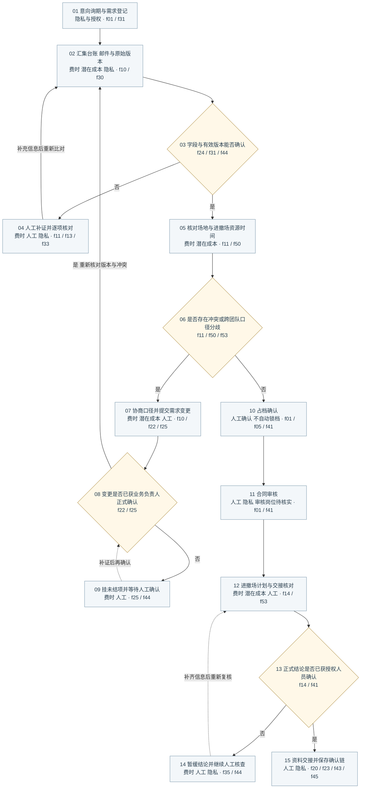

# 展会排期与需求变更访谈流程图

依据：本地 `discovery-report.md` 的六人合成访谈。整理日期：2026年10月23日。

## 图例与阅读方式

主链为 **意向询期 → 占档确认 → 合同审核 → 进撤场计划**。图中共15个节点，包含11个操作和4个人工判断点。

浅蓝圆角框表示操作，浅黄菱形表示判断。实线表示整理后的业务顺序或判断分支，虚线表示补充信息后的返回。侧边异常流程用于集中表达反复核查，不表示异常只发生在图示阶段。

| 标签 | 含义 | 证据性质 |
| --- | --- | --- |
| 费时 | 多源比对、人工逐项核查、沟通和等待 | 访谈直接描述部分痛点；各节点的实际耗时尚未实测 |
| 潜在成本 | 重复人工投入，以及冲突协调、资源重排可能产生的额外投入 | 分析推断；未取得真实金额、单价或损失记录 |
| 人工审核或核对 | 包括操作复核、业务确认和授权审批，具体区别见下文 | 访谈中的控制要求；不表示每个标签都需要相同级别审批 |
| 隐私与授权 | 资料访问、用途限制、只读脱敏导出、留存和删除 | 访谈要求；部分在具体节点上的应用为分析定位，适用于全链路 |

**证据边界：** 原报告明确声明人物、指标和业务问题来自合成演练，不代表企业已核实事实。图中的判断点和回路是对访谈的流程化整理，尚非正式业务制度。具体顺序、岗位、审批层级、等待时限与敏感字段清单均需核实。参考图片只提供版式，不提供本项目业务事实。

## 流程节点与关注点

| 节点 | 业务操作或判断 | 费时或潜在成本 | 人工责任与隐私要求 | 访谈依据 |
| --- | --- | --- | --- | --- |
| 01 | 意向询期与需求登记 | 字段不完整可能触发后续补证；尚无真实耗时 | 核实区域、时间窗等字段；采集和使用资料应在授权用途内 | f01、f31；用途控制见f40、f41 |
| 02 | 汇集台账、邮件与原始版本 | 排期表与邮件不同步；三类工具无统一编号，重复核对消耗人力 | 关联同一申请的原始记录；资料访问限授权范围 | f10、f30、f41 |
| 03 | 判断字段与有效版本能否确认 | 版本断链、缺项会延长核对链条 | 看版本有效期和确认状态；无法确认不能默认通过 | f24、f31、f44 |
| 04 | 人工补证并逐项核对 | 查群消息、翻原始版本、核对原行，往返沟通费时 | 人工澄清；回填时间不等于业务发生时间；原始资料按权限访问 | f11、f13、f33、f41 |
| 05 | 核对场地与进撤场资源时间 | 装卸口重叠、客户延时与恢复检查冲突；可能带来协调和重排投入 | 对照原始版本、资源与时间口径；成本后果仍需验证 | f11、f50、f53 |
| 06 | 判断是否存在冲突或跨团队口径分歧 | 未澄清分歧可能引发重复协商 | 双方围绕同一申请的原始记录核对；不能仅比较汇总表 | f11、f50、f53 |
| 07 | 协商口径并提交需求变更 | 临时变更逐项核对；跨团队协调和返工消耗人力 | 一线可提交变更；登记影响对象和责任，不自动形成正式结论 | f10、f22、f25 |
| 08 | 判断变更是否已获业务负责人正式确认 | 等待确认可能延长周期，真实等待时长未知 | 对应业务负责人完成正式变更确认，模型无审批权限 | f22、f25 |
| 09 | 挂未结项并等待人工确认 | 补证与待确认队列可能累积处理时间 | 未确认项不默认通过，不把责任归给交接对方；补证后再确认 | f25、f44 |
| 10 | 占档确认 | 尚无证据量化本环节耗时或费用 | 正式结论须授权人员确认；试点不自动锁档、签约或承诺容量 | f01、f05、f41 |
| 11 | 合同审核 | 存在该业务环节，尚无真实审核工时及费用 | 审核岗位、层级和字段待核实；合同等资料按授权访问。商业保密不等同于个人信息保护 | f01、f41；节点隐私定位为分析应用 |
| 12 | 进撤场计划与交接核对 | 延时需求与恢复检查口径不一致，可能导致再次核查、协调或重排 | 当班人员复核关键字段；双方核对状态和截止时间，系统建议不能覆盖原值 | f14、f50、f53 |
| 13 | 判断正式结论是否已获授权人员确认 | 无确认不能视为闭环；实际等待时长待测 | 判断正式结论的授权确认是否完成，不能因无冲突而直接放行 | f14、f41 |
| 14 | 暂缓结论并继续人工核查 | 读取失败、关键字段或版本不清会增加核查与等待 | 进入人工队列，必要时暂停；保留上次快照与时间，不编造最新状态 | f35、f44；访问控制见f41 |
| 15 | 资料交接并保存确认链 | 交接不完整可能引发重复核对；真实比例未知 | 列明最新版本、未结项、接收人与截止时间；保留原始版本、修订原因、确认人与访问记录 | f20、f23、f25、f43、f45 |

## 哪些位置费时或可能费钱

**优先测量的费时点是02、04和07。** 一线明确把排期表与邮件对不上、临时变更逐项核对列为痛点；原始版本与群消息的查证又容易形成返工。09和14体现等待与补证，实际等待量与时长需另行采样。05和12涉及资源时间及跨团队口径核对，其发生频次与耗时也尚未量化。

**潜在成本集中在重复劳动和冲突处置。** 02的重复比对直接消耗人工；05、07、12可能带来协调、等待、资源重排或再次核查。访谈没有证明已经发生加班、违约金、客户赔付、设备闲置收费或采购支出，因此本图不把这些写成已发生损失。

原报告的“每月45单、每单35分钟”为虚构基线，不能用于企业成本承诺。f03中的“四周、两名骨干、每周不超过四小时”是演练资源边界，也不是已确认的开发预算；每周四小时为每人还是合计仍需确认。

建议真实取样时分别记录实际操作分钟、等待分钟、补核次数、参与岗位和受影响资源。金额只能在确认内部工时成本或真实费用凭证后估算；不得把所有等待时间直接折算成现金损失。

## 哪些必须由人工审核或确认

| 控制位置 | 已有访谈口径 | 尚未确认的内容 |
| --- | --- | --- |
| 04及12的字段核对 | 当班人员在正式闭环前核对关键字段；系统建议不能覆盖原值或省略确认 | 逐字段复核清单、处理时限和升级类别 |
| 07至09的变更链 | 一线可提交变更，正式确认由对应业务负责人完成；未确认项挂未结项，不转移责任 | 业务负责人具体岗位、备岗和跨团队确认次序 |
| 10、11及13涉及的正式结论 | 所有正式结论均须授权人员确认，模型无审批权限 | 占档、合同、作废及进撤场调整分别由谁审批、审批层级如何设置 |
| 14的异常兜底 | 无法确认版本或关键字段时进入人工队列；必要时暂停，不能默认通过 | 具名接收人、响应时限与暂停后的恢复准入条件 |
| 15的交接 | 保存确认链，交接包含最新版本、未结项、接收人与截止时间 | 谁可关闭未结项，作废后原接收人是否仍需留痕 |

图中的“人工”包括核对和审批两类动作；查资料、字段复核不等同于取得最终审批权。第13节点是交接前的确认完整性检查，不代表只在流程末尾才需要授权。

## 哪些位置需要保护数据隐私

隐私与授权贯穿全部节点，图中重点标注资料接收、汇集、补证、合同审核、异常快照与交接归档的位置。应区分个人信息保护与合同、档期等商业资料的保密要求；具体数据分类尚需核实。

| 数据阶段 | 对应节点 | 访谈要求与分析定位 |
| --- | --- | --- |
| 接收与登记 | 01 | 资料用于已授权的业务目的。若包含联系人、联系方式等个人信息，需核实是否确为必要字段；这些字段仅为待核查示例，原访谈未给出真实字段清单 |
| 汇集、读取与补证 | 02、04、05、14 | 跨企业资料只能按明确授权范围访问；原始邮件、群消息、版本和快照不应越权共享。保留原行用于追溯，不等于允许所有人查看 |
| 试点数据导出 | 横向控制，适用于全链路 | 只开放脱敏只读导出；不开放写回、外部消息和执行接口。该限制属于试点数据路径，不替代业务主链 |
| 合同与变更资料流转 | 07至12 | 依据跨企业访问和授权用途要求控制资料流转；合同、变更单的具体敏感字段及接收方范围待确认 |
| 审计、留存与删除 | 15及后续资料生命周期 | 保存谁查询、使用哪个版本、提出何种建议及谁确认；留存原始版本与修订原因。练习结束按约删除虚构个人字段。期限、删除责任人与审计频次尚未核实 |

留存、删除与每周复盘是横向治理要求，未另画为新增业务步骤。不能自行设置一个未经确认的留存年限，也不能把“删除个人字段”解释为清空全部业务证据。

## 六位访谈对象

| 合成访谈对象 | 角色 | 信息与职责 |
| --- | --- | --- |
| 顾明岚 | 业务负责人 | 业务目标、试点范围、决策权及边界，f00至f05 |
| 林亦舟 | 一线服务专员 | 异常识别、问题记录、原始版本追溯及当班复核，f10至f15 |
| 唐映秋 | 项目流程协调员 | 四段主链、版本、交接、未结项与责任清单，f20至f25 |
| 秦芮 | 数字化工程师 | 三类工具、字段关联、只读脱敏导出与失败快照，f30至f35 |
| 傅景 | 审核与质量负责人 | 授权确认、人工兜底、审计留存与试点验收，f40至f45 |
| 叶书 | 客户协同代表 | 跨团队口径、结果用途、客户反馈与共同复盘，f50至f55 |

上述姓名均来自合成场景，不应直接作为真实项目责任人名单。fNN是 `dlg-venue-schedule-fNN` 的简写，原始依据见 [discovery-report.md](../../data/source/discovery-report.md)。

## 可编辑流程源代码

以下Mermaid与PNG使用相同节点和分支；不同编辑器的自动布局可能与参考图不同，PNG为排版后的定稿。

## 版式说明

纵向主链保留连续的业务阅读路径，异常核查放在右侧。留白用于区分主链、返工和横向控制，避免把注释误读为流程节点。

操作框采用浅蓝，判断框采用浅黄，与参考图的视觉语法保持一致。四类文字标签分别使用橙、红、紫、绿，标签本身保留类别名称，避免只靠颜色传达含义。

全图采用微软雅黑，用字号和粗细形成标题、节点、说明与证据编号的层级。解释集中放在下方，节点内部只保留动作、关键约束和来源。

连接线使用直角转折并避开文字，返回路径使用虚线或明确的返回说明。人工判断、潜在成本和隐私要求均可回到访谈编号，具体制度未确认的部分保留限定语。
