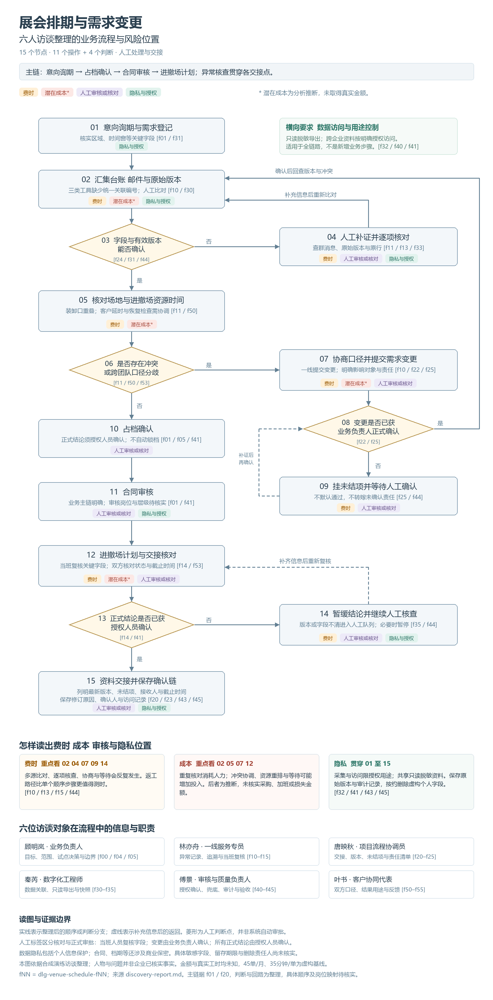
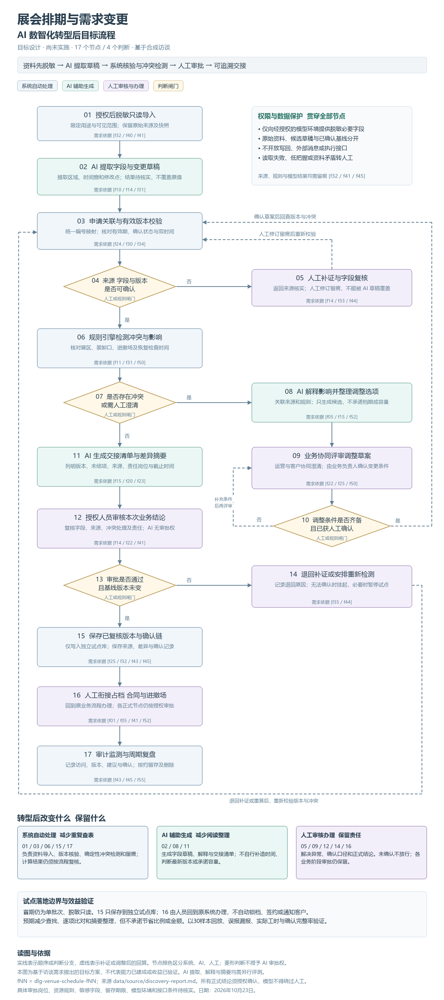

# 改造前后流程与人工控制
流程原设计日期 2026年10月23日　说明整理日期 2026年11月6日

本册复用既有两张流程图，结合装卸口冲突事件说明改造思路，并单独列出当前 MVP 已实现的人工操作。改造前图来自合成访谈，改造后图是完整目标方案，不能把整张目标图当成当前系统功能。

## 典型事件的流程变化
| 环节 | 现状痛点 | AI 或系统改造 | 人工责任 |
| --- | --- | --- | --- |
| 查找 | 邮件与台账分散 | 关联来源，AI 提取候选 | 确认来源范围与字段 |
| 比对 | 装卸口区间重叠 | 规则计算并显示重叠时段 | 确认互斥和缓冲规则 |
| 调整 | 新旧版本不同步 | 展示差异，AI 整理影响 | 决定调整方案 |
| 交接 | 未结项和责任不清 | 结构化状态、摘要和记录 | 确认提交与审核 |

## 当前 MVP 的三处人工点
H1 为员工核对完整预览后确认创建草稿，拒绝则不建草稿；H2 为本人在“我的草稿”主动提交，创建确认不代替提交；H3 为获场馆审核授权的其他管理员复核后通过或退回，退回须写明原因。三处均由服务端校验，聊天中的“确认”不能替代操作。

正式占档、原排期切换、合同和通知仍在现有应用之外。原两图的节点和证据说明见 ../process/ 中对应 Markdown，图中的目标动作应按需求 R01 至 R10 的状态逐项验收。

## 改造前流程

主链为意向询期、占档确认、合同审核、进撤场计划。多源信息汇集后，需要人工查找来源、识别有效版本、逐项比对资源时间，存在异常时协商、补证和再次确认。装卸口事件定位在“核对场地与进撤场资源时间”和“冲突或口径分歧”两处；35 分钟核对是补充演练值，并非图中各节点实测时长。

## 改造后目标流程

目标把来源整理、字段提取和交接摘要交给系统与 AI 辅助，将资源时间计算、版本检查交给确定性规则，正式结论由人员复核。存在缺项、来源读取失败或版本改变时回到补证或重算，不自动以“无冲突”放行。
