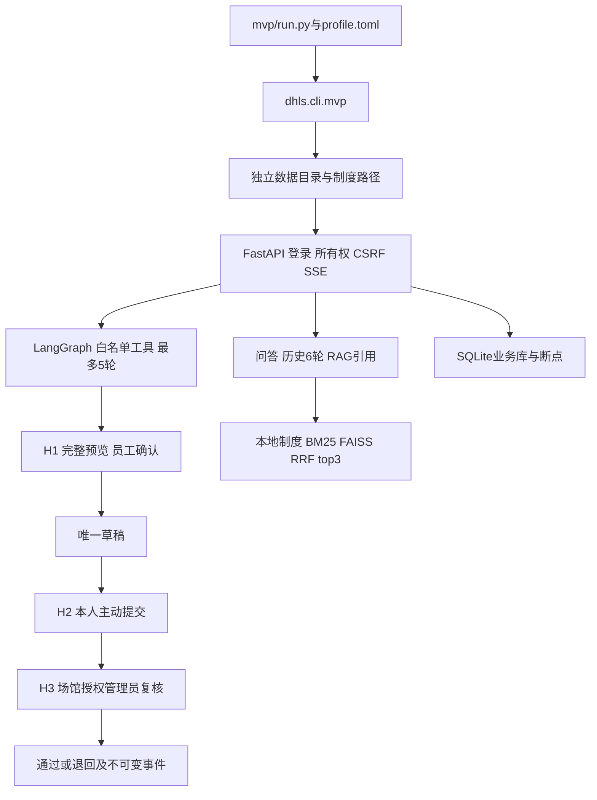

# MVP工程架构

核心源码统一位于 `src/dhls/`，`mvp/`保存配置、知识资料和验收入口。原有 `python -m dhls` 继续使用原默认目录，MVP通过 `dhls.cli.mvp` 选择独立目录；不迁移旧数据库、不复制一份审批状态机。

| 组件 | 实现文件 | 核心职责 |
| --- | --- | --- |
| 入口配置 | [cli/mvp.py](../src/dhls/cli/mvp.py) | TOML路径、只读doctor、服务和维护命令统一目录 |
| 服务 | [main.py](../src/dhls/main.py) | 应用生命周期、账号页面、SSE和错误信封 |
| 问答 | [core/chat.py](../src/dhls/core/chat.py)、[rag.py](../src/dhls/core/rag.py) | 本地检索、历史、来源和后端模型调用 |
| Agent | [core/agent_loop.py](../src/dhls/core/agent_loop.py) | 单工具决策、预算、原生中断及恢复 |
| 状态 | [core/agent_state.py](../src/dhls/core/agent_state.py) | 运行所有权、日志、预览摘要、确认和幂等 |
| 业务工具 | [core/agent_business.py](../src/dhls/core/agent_business.py) | 授权、凭据、资源、版本和草稿事务 |
| 人工审批 | [core/approvals.py](../src/dhls/core/approvals.py)、[api/approvals.py](../src/dhls/api/approvals.py) | 本人提交、场馆复核、禁止自审和事件 |
| 身份和锁 | [core/auth.py](../src/dhls/core/auth.py)、[utils/locks.py](../src/dhls/utils/locks.py) | Argon2、JWT、CSRF及单目录OS实例锁 |
| 页面 | [templates](../src/dhls/templates)、[static](../src/dhls/static) | 问答、Agent、草稿、审批和原生SVG统计 |

## 持久化与运行约束

MVP默认 `.runtime/chat/chat.sqlite3` 保存账号、会话、消息、run、日志、凭据、草稿及审批事件；同目录 `agent-checkpoints.sqlite3`保存LangGraph断点，签名文件独立于模型密钥。`.runtime/rag/`保存模型和检索索引，制度来源为 `knowledge_base/policy.md`。

应用仅监听127.0.0.1、单worker。重启不返还已扣的模型轮次；未确认草稿不会自动写入。提交与通过时重新复核当前授权、容量、资源冲突和原排期版本。通过请求还需页面当前的review_hash，陈旧或并发决定返回409。

## 已实现与待建设

已实现的三处人工点分别来自三个独立HTTP边界，不是同一弹窗重复计数。MVP复用真实服务，不增加模拟业务页面、测试账号旁路或任意SQL工具。演示规则100人、独占、0缓冲和72小时上限为试点夹具，不代表正式制度。

普通制度仍由已登录账号共用，文档ACL及上传管理未完成；新run不自动记忆前run参数；审批不生成占用，不切换旧排期。生产身份、规则、占档事务、脱敏、留存与并发容量必须另行验收。
